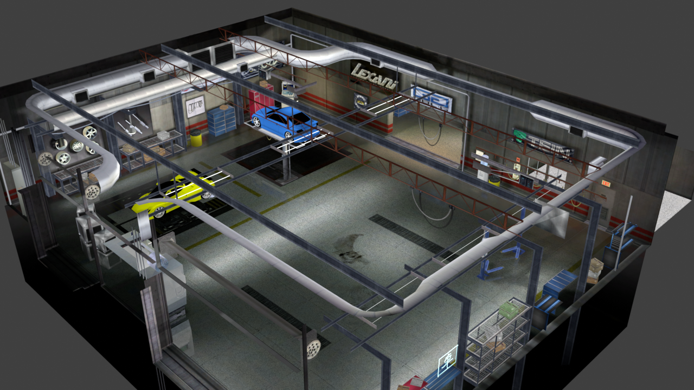
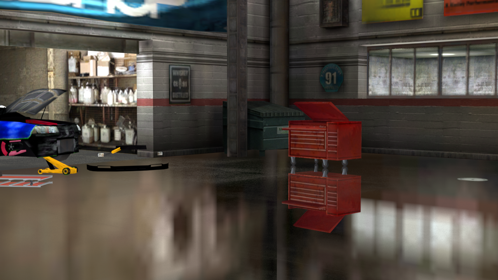
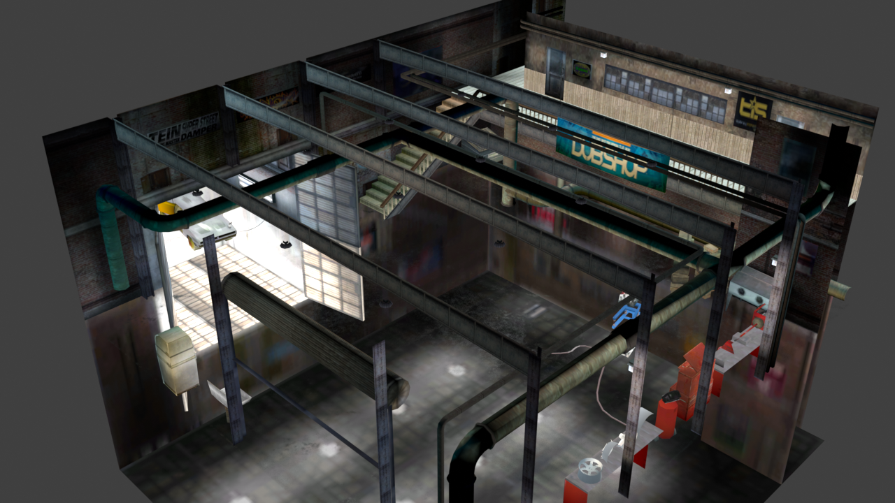
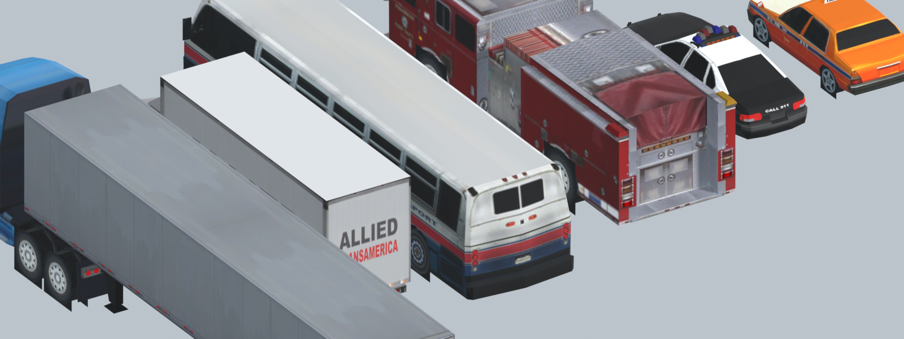

# MC3 Garage-Vehicles Importer

A Blender add-on and a set of Python tools that import the **garages** and **traffic vehicles** of *Midnight Club 3: DUB Edition Remix* (original Xbox) from your own copy of the game, with textures, lightmaps and the game's baked lighting. It can also convert them to glTF (`.glb`) for use in any other 3D program.

It was made to build dioramas and renders of the game's garages.



> [!IMPORTANT]
> **Disclaimer.** This is an unofficial, non-commercial fan project made as a hobby. It is **not affiliated with, endorsed by or connected to** Rockstar Games, Take-Two Interactive or any of the game's developers or publishers. *Midnight Club* and all related names, models and textures are the property of their respective owners.
>
> This repository contains **no game files or game assets**. To use it you need your own legally obtained copy of the game. Please do not redistribute the extracted models or textures.

## Features

- **The 4 garages:** San Diego, Atlanta, Detroit and Tokyo, each in every time-of-day and weather variant (dawn / dusk / midnight × clear / cloudy / rainy).
- **The 42 traffic vehicles:** cars, taxis, police cars, ambulances, buses, trucks, trains and the San Diego tram, with wheels positioned by the vehicle skeleton.
- **Reads the game directly:** works straight from the Xbox ISO or from a folder containing the `assets_x.dat*` files. No manual extraction step is needed.
- **Two shading modes:**
  - **Game lighting (baked):** diffuse × lightmap × vertex color as emission, so it looks like the game without any scene lights.
  - **PBR:** Principled BSDF with the diffuse texture, so you light the scene yourself.
- **glTF export from the command line:** for Unity, Unreal, 3ds Max, Maya and other programs.
- **No dependencies:** pure Python standard library. Nothing to install besides Blender.

## Requirements

- Blender **4.1 or newer** (tested on 4.1 and 5.2).
- Your own copy of *Midnight Club 3: DUB Edition Remix* for the original **Xbox**, in one of two forms:
  - an ISO image (redump or trimmed `.xiso`), or
  - a folder with the game's `assets_x.dat`, `assets_x.dat_1` … `assets_x.dat_5`.

## Installing the add-on

1. Download `io_import_mc3.zip` from the [Releases](../../releases) page, or build it yourself:
   ```
   python build_addon.py
   ```
   This creates `dist/io_import_mc3.zip`.
2. In Blender, go to **Edit › Preferences › Add-ons**, open the drop-down at the top right, choose **Install from Disk…** and pick the zip.
3. Make sure **Midnight Club 3 Importer** is enabled.

## Usage

All importers live under **File › Import › Midnight Club 3**.

### Garages

1. Choose **San Diego / Atlanta / Detroit / Tokyo Garage**.
2. Select the game's ISO, or any `assets_x.dat*` file inside the game folder.
3. Optionally, in the file browser side panel (gear icon or **N**), pick:
   - **Time of day** and **Weather**. They only change the baked lighting.
   - **Shading**: *Game lighting (baked)* or *PBR*.
   - **Lighting strength**: 2.0 by default, matching the Xbox's 2× modulation.

Each garage is imported into its own collection, under an empty named after the garage.



#### Objects in a garage

| Object | Contents | Diorama tip |
|---|---|---|
| `*_prop_garage_x` and walls/roof pieces | Main room: walls, ceiling, posters | Keep |
| `*_prop_garage_floor*` | Floor. Semi-transparent, because of the fake reflection below. | Keep. Remove the alpha for a solid floor. |
| props, tires, railings, decals… | Tools, parts, shelves | Keep |
| `*_prop_garage_skyline_x` and others | Background cars (Nissan Skyline in San Diego, Infiniti and others in Tokyo) | Keep |
| `*_reflect*` / `*_reflection*` | Mirrored copy of the props under the floor. This is how the game fakes floor reflections. | **Hide** |
| `*_hdr*` | Additive glows and halos | Optional |

The garage walls only have inward-facing faces, as in the game. Enable **Backface Culling** in the material settings to get a cutaway view that looks like a diorama.



### Traffic vehicles

1. Open **Traffic Vehicles** and pick a category: *Cars, Taxis, Police, Emergency & Service, Buses, Trucks & Vans* or *Trains & Tram*.
2. Click the vehicle you want. The suffix tells the city: `(San Diego)`, `(Tokyo)`, `(all cities)`, and so on.
3. Select the ISO or an `assets_x.dat*` file.

Vehicles default to **PBR** shading. In the game their lighting is computed in real time, so there is no baked lighting to reuse.



### Placing a vehicle inside a garage

Because the garage materials are emissive in *baked* mode, the garage itself lights anything you put inside it when you render with **Cycles**. Import a garage, import a vehicle, move it into place and render.

- **Contact shadows and real floor reflections:** switch the floor material to a Principled BSDF that uses the baked texture as *Base Color*, then add a couple of weak area lights under the ceiling lamps.
- **EEVEE:** works too with *Raytracing* enabled, but emissive surfaces contribute less light than in Cycles.

## Command-line tools (no Blender needed)

Python 3.8+ is enough. These tools use only the standard library.

```bash
# A garage straight from the ISO to glTF, plus its textures as PNG
python mc3tools/convert.py "<game.iso>" sd_garage.glb --city sd --time midnight --weather clear --png textures/

# One traffic vehicle, or all of them into a folder
python mc3tools/convert.py "<game.iso>" taxi.glb --vehicle va_taxi_s
python mc3tools/convert.py "<game.iso>" vehicles/ --vehicle all

# Low-level tools: list/extract the ISO and the Dave archives
python mc3tools/xiso.py list "<game.iso>"
python mc3tools/xiso.py extract "<game.iso>" extracted/iso assets_x.dat
python mc3tools/extract.py extracted/iso extracted/assets garage_props
```

In the `.glb` files, the lightmap is stored as an *occlusion texture* on UV 1, because glTF has no lightmap slot. The game's shader information is kept in each material's `extras`.

## Known limitations

- **Player cars:** the cars you drive are not supported yet. They use a different set of files.
- **Traffic car paint:** the game tints some civilian cars with a random paint color at runtime. They are imported with the texture's own color.
- **Reflections:** car reflections and environment maps are approximated: glass becomes a dark, slightly transparent material.
- **Tested edition:** only the North American *Remix* release for the original Xbox (`Midnight Club 3 - DUB Edition Remix (USA)`) has been tested. Other regions or platforms (PS2, PSP, PS3) use different files and are not supported.

## How it works

The formats were reverse engineered for this project. A short summary:

| Format | Description | Code |
|---|---|---|
| ISO | Standard XDVDFS | [`mc3tools/xiso.py`](mc3tools/xiso.py) |
| `assets_x.dat*` | Six independent **Dave** archives. Entries are raw-deflate compressed. Names are packed 6 bits per character, and each name can reuse a prefix from the previous one. | [`mc3tools/dave.py`](mc3tools/dave.py) |
| Garages: `resources/prop/<city>_<time>_<weather>_garage_props.xbck` | Raw memory dumps with absolute Xbox pointers. Objects are recognised by structure because vtables differ between builds. Meshes are triangle strips with 24/32-byte vertices. Pieces are placed by instance records (position + yaw). | [`mc3tools/xbck.py`](mc3tools/xbck.py), [`mc3tools/scene.py`](mc3tools/scene.py) |
| Textures | Original Xbox D3D textures (DXT1/DXT5 or swizzled ARGB) | [`mc3tools/textures.py`](mc3tools/textures.py) |
| Vehicles: `vehicle/va_*/` | Plain-text `.type`, `.skel` and `.mesh` files, plus `.tex` textures | [`mc3tools/vehicle.py`](mc3tools/vehicle.py) |

More details are in the docstrings at the top of each module.

## Project layout

```
blender_addon/io_import_mc3/   Blender add-on (UI, materials, mesh building)
mc3tools/                      Format readers and converters (no Blender dependency)
build_addon.py                 Packs the add-on + mc3tools into dist/io_import_mc3.zip
docs/images/                   Screenshots for this README
```

## License

The add-on manifest declares **GPL-3.0-or-later**, as required for Blender add-ons. This license covers only the code in this repository, not the game or its assets.
